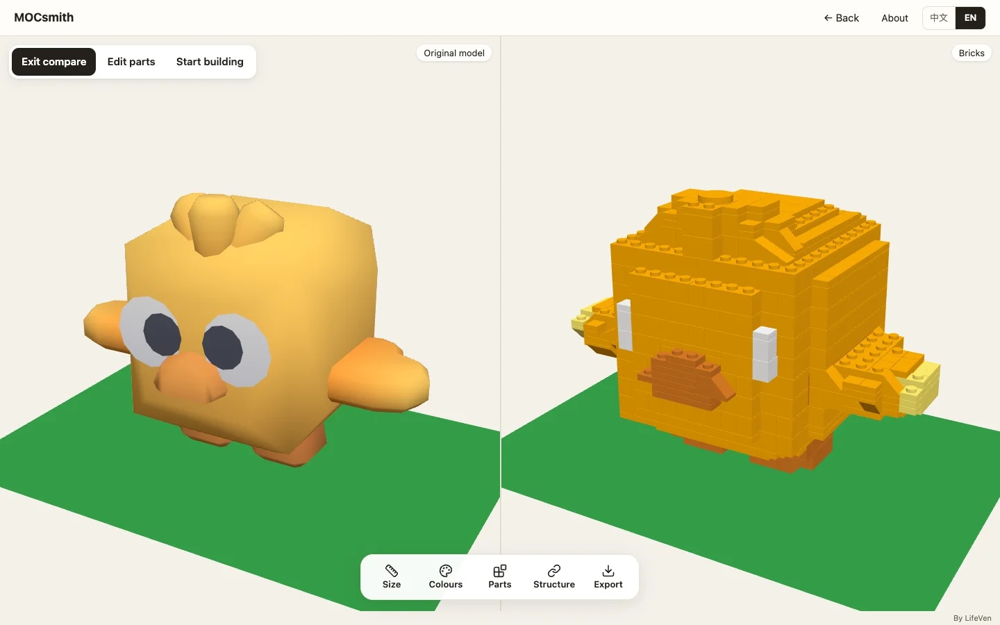
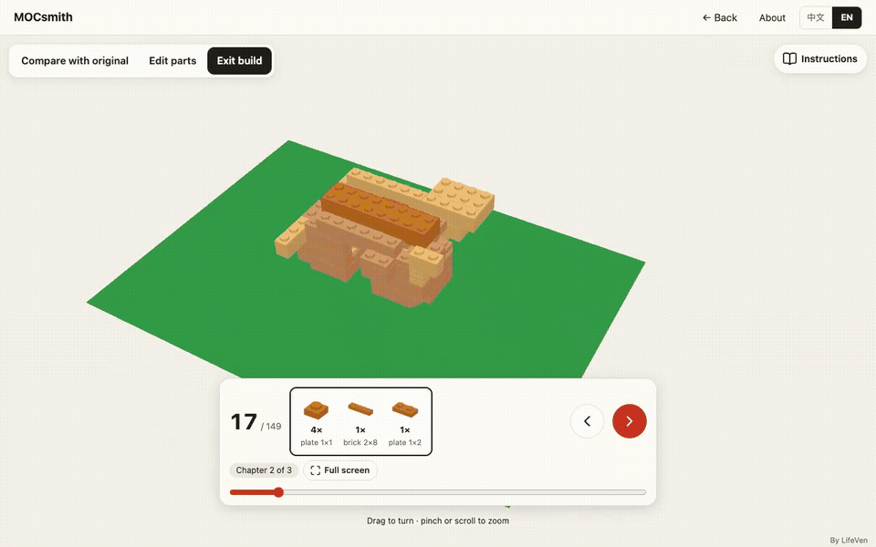
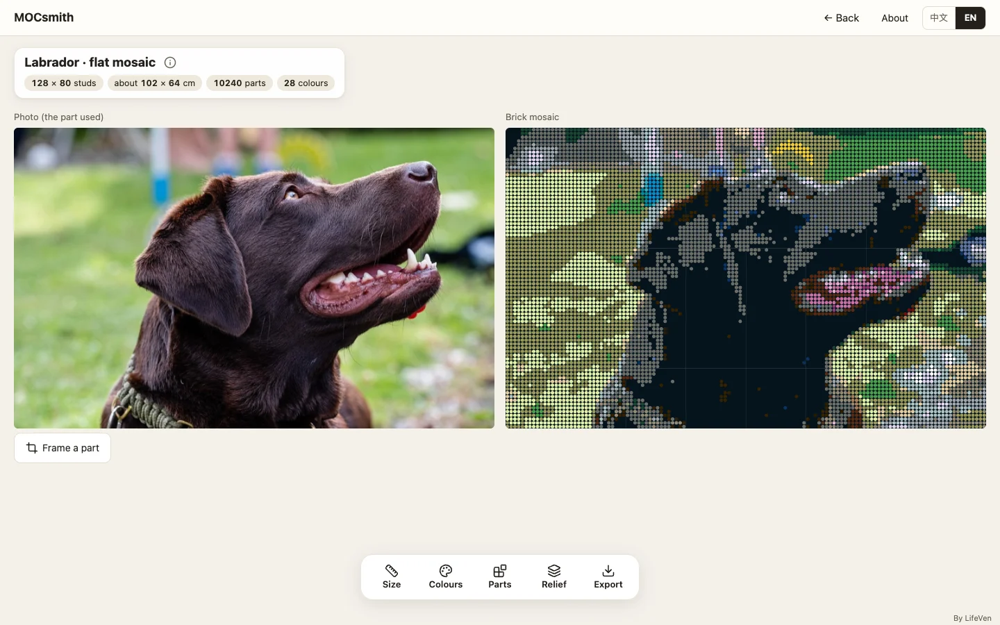

# MOCsmith

**Turn 3D models into editable brick designs.**

Open a model, choose a size, refine the parts and colours, then follow the building steps or download a PDF instruction book. You can also turn a photo into a brick mosaic, using a colour palette or the parts in your own sets.

[Try MOCsmith](https://mocsmith.lifeven.com/) · [How it works](docs/ALGORITHMS.md) · [Run locally](#run-locally) · [Contribute](CONTRIBUTING.md)



## Make it your own

- **Model to bricks.** Import GLB or LDraw files, or choose a bundled sample. Change the size, colour count and part types; compare the result with the original.
- **Edit individual parts.** Select, recolour, add, move or remove pieces, with undo and redo. Inspect disconnected parts before building.
- **Follow the assembly.** Step through a generated sequence with chapters, subassemblies, a parts box and camera views. The PDF book and LDraw export use the same plan.
- **Photo to mosaic.** Crop a picture, choose surface pieces and base panels, fit colours to an inventory, or add optional 2.5D relief.
- **Take the design with you.** Download PDF instructions, an LDraw model or a CSV parts list.



## How it works

The conversion pipeline samples the model into a stud-and-plate grid, groups nearby surface colours, lays out parts and checks their connections. Surface passes replace eligible areas with slopes, tiles and round parts. Local graph updates let those edits be checked without rebuilding every connection.

The forward planner adds parts to the existing assembly, checking placement access and grouping nearby work into steps. Rendering, playback and exports consume one shared plan, so an edited model carries through to the instruction book.

Mosaics use perceptual colour matching, optional error diffusion and inventory-aware assignment. Optional relief estimates depth locally with Depth Anything V2 Small.

Read the [algorithm guide](docs/ALGORITHMS.md) for implementation details, constraints and references, or the [architecture guide](docs/architecture.md) for the module boundaries. Algorithm and asset credits are preserved in [NOTICE](NOTICE) and [credits](docs/credits.md).

## Run locally

Use Node 24 LTS. The app needs no account, API key or backend.

```sh
git clone https://github.com/lifeven/mocsmith.git
cd mocsmith/app
npm ci
npm run dev
```

Open `http://127.0.0.1:5591/`. To run the tests and build:

```sh
npm run check
npm run preview
```

The production preview runs at `http://127.0.0.1:5592/`. Browser regression checks are described in [Contributing](CONTRIBUTING.md). Normal builds use the included processed data and samples; optional data-generation tools are separate.



## Your files stay in your browser

Models and photos are processed on your device. Set names and inventories load from this site. Enabling 2.5D relief downloads a depth model from Hugging Face, then runs it locally. The app has no accounts, ads or analytics.

Editing lives in the current browser session. Export before closing the page; LDraw preserves parts and generated step markers, rather than a complete editable project. Connectivity checks help find detached parts, but do not calculate structural forces. Manual step sequencing and image-to-3D generation are not available.

## Documentation and contributions

- [Product guide](docs/PRODUCT.md): workflows, formats and limits.
- [Algorithm guide](docs/ALGORITHMS.md): conversion, connectivity, steps and mosaics.
- [Architecture](docs/architecture.md): module responsibilities and data flow.
- [Build and deployment](docs/PUBLICATION.md): static hosting and configuration.
- [Validation](docs/STATUS.md): checks and their scope.
- [Contributing](CONTRIBUTING.md): local checks, bug reports and focused changes.

Found a problem? [Open an issue](https://github.com/lifeven/mocsmith/issues) with steps to reproduce and a small sample you have permission to share. Improvements to conversion quality, assembly access, file compatibility and accessibility are welcome.

## Licence and credits

By [LifeVen](https://www.lifeven.com/). Application code is **AGPL-3.0-only**, with the attribution and name terms in [NOTICE](NOTICE). Project documentation is CC BY 4.0; dependencies, data and sample assets retain their own licences. See [LICENSE](LICENSE), [LICENSE-docs](LICENSE-docs) and [credits](docs/credits.md).

LEGO® is a trademark of the LEGO Group, which does not sponsor, authorise or endorse this project. This licence grants no rights to the MOCsmith or LifeVen names.
